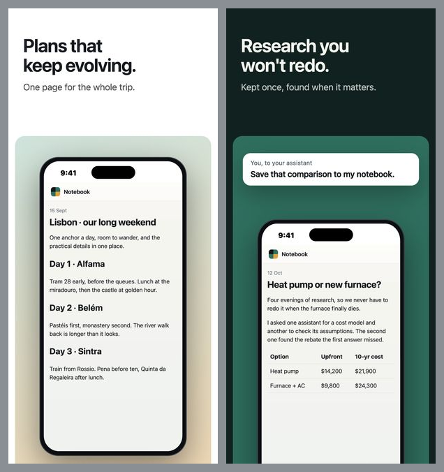

# app-marketing-assets

A [Claude Code](https://claude.com/claude-code) plugin that makes your product's
marketing images from **your real, running app**: landing-page screenshots,
responsive cropped derivatives, App Store / Google Play / Mac App Store / Chrome
Web Store screenshots, promo tiles and social cards. When the UI changes, one
run brings every image up to date.



It is a skill (the method: what to show, what to hide, how to crop, how to
review) plus small Node scripts driven by one config file. Claude reads the
skill, writes your config, runs the scripts, and shows you a before/after
review page. You can also run the scripts yourself.

## What it handles

- **Signs in** as a seeded demo account (any flow: a demo button, a test
  login) and reuses the session; mobile and app-user-agent sessions share it.
- **Waits for the real page**: skeletons, "loading" text, local-first "not
  synced yet" states are waited out or reloaded, never captured.
- **Hides the environment**: dev badges, banners, toasts, the pointer.
- **Captures at display size** at 2–3× device scale, so text is sharp. Element,
  clip, viewport or full-page; fixed toolbars land at the bottom, not mid-image.
- **Uses real Chrome** when installed. Playwright's headless shell renders
  frosted-glass (`backdrop-filter`) UI wrong.
- **Derives** cropped WebP at several widths, never upscaled, plus a JSON
  manifest with content hashes for `srcset` and cache busting.
- **Composes store screenshots**: headline, line, prompt bubble, device frame,
  photo or color, at each store's exact size, as JPEG without alpha.
- **Scrubs third-party trademarks** ("ChatGPT", "Claude"…) from store shots,
  and fails a shot if any remain. App stores can reject listings that show them.
- **Measures crops**: finds which part of each image a page ever shows, across
  viewport widths, so you don't ship masked pixels.
- **Review sheet**: every changed image beside its committed version.

## Install

As a plugin:

```
/plugin marketplace add klocekian/app-marketing-assets
/plugin install app-marketing-assets@app-marketing-assets
```

Or copy `skills/app-marketing-assets/` into your project's `.claude/skills/`
(or `~/.claude/skills/` for all projects).

Your project needs `playwright` and `sharp`:

```
npm i -D playwright sharp
```

Google Chrome is recommended; otherwise run `npx playwright install chromium`.

## Use

Ask Claude something like:

> Set up marketing screenshots for this app.
> We redesigned the header; refresh the screenshots.
> Make App Store screenshots that follow the landing page.

Or run the scripts from your project root (`<skill>` = where the skill is installed):

```bash
node <skill>/scripts/preflight.mjs          # checks + warms the dev server
node <skill>/scripts/capture.mjs            # --only=a,b  --no-crop  --debug  --list
node <skill>/scripts/derive.mjs             # responsive derivatives + manifest
node <skill>/scripts/compose-store.mjs      # --preset=ios-6.9|ios-6.5|ipad-13|android-phone|mac-app-store|chrome-web-store
node <skill>/scripts/render-html.mjs        # HTML → PNG (promo tiles, OG cards)
node <skill>/scripts/measure-crops.mjs /    # what each image on a page shows
node <skill>/scripts/review-sheet.mjs       # before/after review page
```

Start from [`templates/marketing-assets.config.mjs`](skills/app-marketing-assets/templates/marketing-assets.config.mjs).
All fields: [`references/config.md`](skills/app-marketing-assets/references/config.md).

## Try it on the demo app

```bash
git clone https://github.com/klocekian/app-marketing-assets && cd app-marketing-assets
npm install
npm run demo &                       # http://localhost:4321
cd examples/demo-app
node ../../skills/app-marketing-assets/scripts/preflight.mjs
node ../../skills/app-marketing-assets/scripts/capture.mjs
node ../../skills/app-marketing-assets/scripts/compose-store.mjs
open out/store/contact-sheet.png
```

`npm test` runs every script against the demo app and checks the output.

## Store sizes

[`references/store-specs.md`](skills/app-marketing-assets/references/store-specs.md)
lists sizes and content rules for each store, with links. Stores change them,
so confirm against the linked page before you submit.

## Origin

Extracted from the pipeline behind the landing page, guides and App Store
listing of [Notations](https://notations.app), where every product image is
regenerated from the app after each UI change.

## License

MIT
